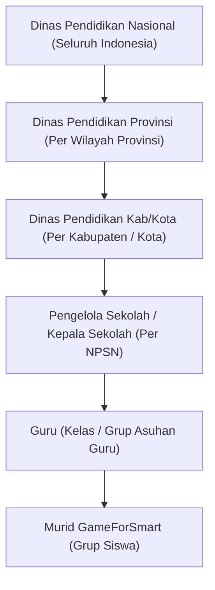
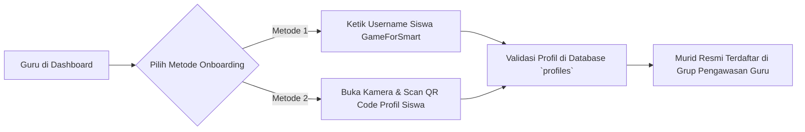
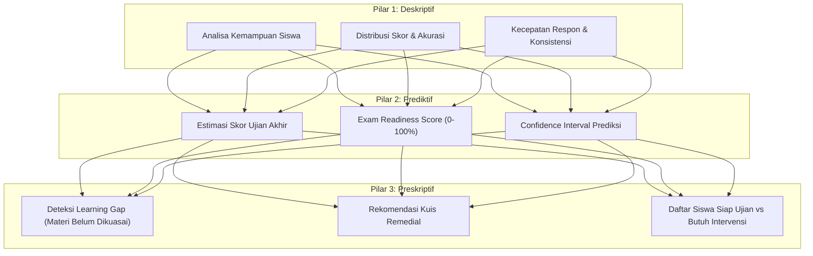
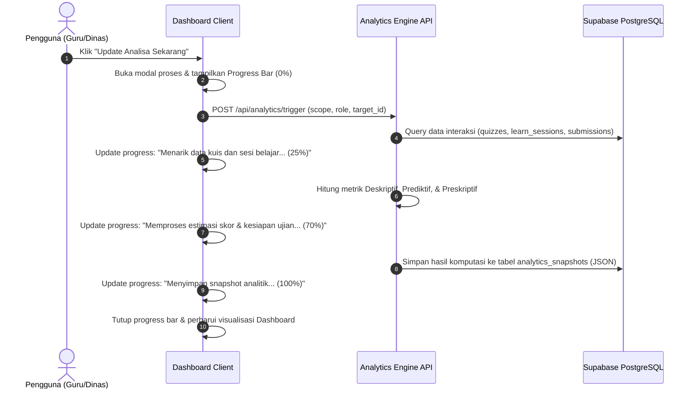
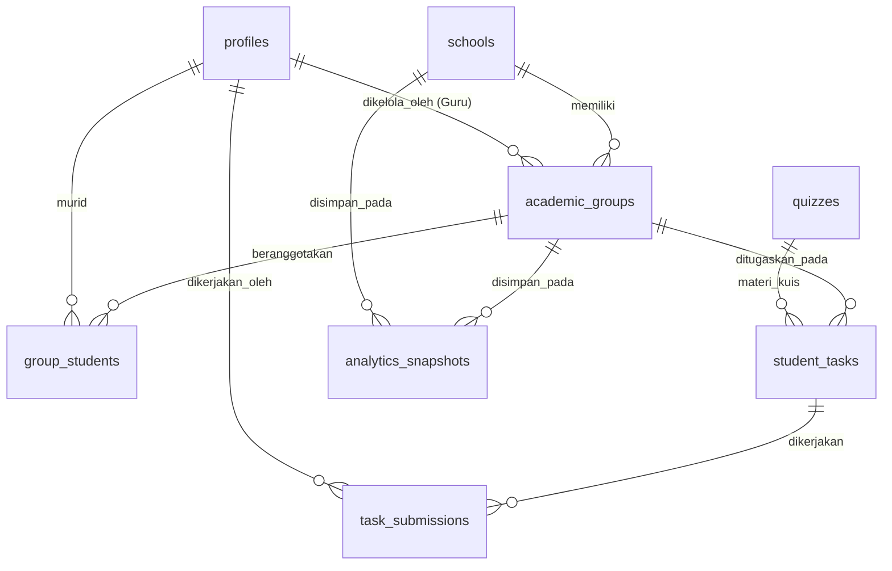

# Product Requirements Document (PRD)
## GameForSmart - AnalyticsDashboard (Educational Intelligence & Monitoring Platform)

**Version:** 1.0  
**Product Name:** GameForSmart AnalyticsDashboard  
**Platform:** Web Application (Responsive Desktop & Tablet-First)  
**Target Users:** Guru, Pengelola Sekolah, Dinas Pendidikan Kab/Kota, Dinas Pendidikan Provinsi, Dinas Pendidikan Nasional  
**Technology Stack:** Next.js 16, Tailwind CSS v4, shadcn/ui, TypeScript, Supabase 

---

## 1. Executive Summary

### 1.1 Latar Belakang
Platform **GameForSmart** telah berhasil menghadirkan lingkungan belajar yang interaktif melalui gamifikasi kuis, kompetisi kuis berjenjang, dan sesi belajar mandiri (`learn_sessions` & `game_sessions`). Setiap sesi interaksi siswa menghasilkan jejak data yang sangat kaya: pola jawaban, tingkat ketelitian, kecepatan merespon (response time), tingkat kesulitan soal yang ditaklukkan, serta riwayat repetisi kuis.

Meskipun demikian, data berharga tersebut selama ini masih terisolasi di sisi operasional game dan admin umum (`gameforsmartNewUI` dan `admin_dashboard`), tanpa adanya agregasi analitik yang dapat langsung dimanfaatkan oleh stakeholder pendidikan:
- **Guru** kesulitan memetakan siswa mana yang belum menguasai indikator pembelajaran tertentu dan membutuhkan bimbingan khusus.
- **Pengelola Sekolah** tidak memiliki alat ukur objektif untuk membandingkan kesiapan akademik antarkelas dalam menghadapi ujian resmi.
- **Dinas Pendidikan (Kabupaten/Kota, Provinsi, dan Nasional)** tidak memiliki data real-time berbasis bukti (*evidence-based policy*) untuk melihat sekolah mana yang telah mencapai target kompetensi nasional atau yang memerlukan intervensi bantuan kurikulum.

**GameForSmart AnalyticsDashboard** hadir sebagai solusi intelijen pendidikan (*Educational Intelligence System*) yang mengolah big data interaksi kuis menjadi wawasan komprehensif melalui tiga pilar analitik: **Deskriptif**, **Prediktif**, dan **Preskriptif**.

---

## 2. Tujuan Produk (Product Objectives)

### 2.1 Tujuan Utama
1. **Analisa Kemampuan Siswa Multi-Dimensi (Deskriptif):** Memberikan gambaran akurat mengenai profil penguasaan mata pelajaran per siswa, per kelas, dan per sekolah.
2. **Estimasi Kesiapan Ujian (Prediktif):** Memprediksi potensi capaian skor ujian akhir/nasional siswa pada mata pelajaran tertentu berdasarkan trend historis data kuis, lengkap dengan tingkat kesiapannya (*Readiness Index*).
3. **Penyembuhan Kesenjangan Belajar (Preskriptif):** Menemukan topik atau indikator kompetensi dasar yang belum tuntas (*learning gap*) dan memberikan rekomendasi penugasan/remedial terarah.
4. **Sentralisasi Hierarki Pendidikan:** Menghubungkan guru, pimpinan sekolah, hingga pengawas dinas pendidikan dalam satu ekosistem data yang terpadu berdasarkan Nomor Pokok Sekolah Nasional (NPSN).
5. **Aksi Nyata Pengajaran:** Menyediakan kanal penugasan tugas (*Task Assignment*) dari guru langsung ke murid dengan tracking pengerjaan real-time.

### 2.2 Indikator Keberhasilan (KPI)
- **Akurasi Prediksi Ujian:** Korelasi hasil prediksi skor dengan capaian riil siswa mencapai $\ge 85\%$.
- **Adopsi Guru:** Guru aktif membuat grup pengawasan dan memberikan minimal 2 penugasan per bulan $\ge 70\%$.
- **Kecepatan Akses Analitik:** Waktu load dasbor analitik cached $< 1.5$ detik; waktu pemrosesan analitik batch $< 15$ detik dengan live progress feedback.
- **Cakupan Sekolah:** Terkoneksi dengan direktori NPSN nasional untuk pemetaan otomatis di tingkat daerah.

---

## 3. User Personas & Hierarki Peran

Platform dirancang dengan hierarki akses berjenjang (*Hierarchical Role-Based Access Control* / HRBAC) sebagai berikut:



### 3.1 Profil Peran Pengguna

| Peran | Profil & Tanggung Jawab | Cakupan Pengawasan (Scope) |
| :--- | :--- | :--- |
| **Guru (Teacher)** | Pendidik di sekolah yang membina satu atau beberapa kelas pada jenjang/tingkat tertentu. Membutuhkan detail per individu siswa. | Grup/kelas asuhan guru tersebut (dapat lintas jenjang/tingkat sesuai penugasan mengajar). |
| **Pengelola Sekolah (School Admin / Principal)** | Kepala Sekolah, Wakil Kepala Kurikulum, atau Admin IT Sekolah yang memantau kualitas institusi. | Seluruh kelas, seluruh jenjang, dan seluruh guru di dalam satuan pendidikan (NPSN) yang dikelolanya. |
| **Dinas Pendidikan Kab/Kota** | Pejabat dinas tingkat kabupaten/kota (misal: Disdik Kota Surabaya). Memantau jenjang PAUD/TK, SD, SMP di daerahnya. | Seluruh sekolah (NPSN) yang berada dalam yurisdiksi kabupaten/kota terkait. |
| **Dinas Pendidikan Provinsi** | Pejabat dinas tingkat provinsi (misal: Disdik Jawa Timur). Memantau jenjang SMA, SMK, dan SLB. | Seluruh kabupaten/kota dan seluruh sekolah tingkat menengah di provinsi terkait. |
| **Dinas Pendidikan Nasional** | Kementerian Pendidikan Dasar dan Menengah (Kemendikdasmen). Analisis makro mutu pendidikan nasional. | Agregasi nasional seluruh provinsi, kabupaten/kota, dan sekolah di Indonesia. |

### 3.2 Permission Matrix (Matriks Hak Akses)

| Modul / Fitur | Guru | Pengelola Sekolah | Dinas Kab/Kota | Dinas Provinsi | Dinas Nasional |
| :--- | :---: | :---: | :---: | :---: | :---: |
| **Login & Profil** | Semua | Semua | Semua | Semua | Semua |
| **Cari & Klaim NPSN Sekolah** | Terikat Akun | Admin Utama | View Regional | View Regional | View Nasional |
| **Bentuk Grup Pengawasan** | Buat/Ubah | Kelola Semua | Hanya Baca | Hanya Baca | Hanya Baca |
| **Tambah Murid via Username / QR** | Ya | Ya | Tidak | Tidak | Tidak |
| **Berikan Task / Tugas ke Murid** | Ya | Tidak | Tidak | Tidak | Tidak |
| **Evaluasi Progres Tugas** | Ya | Monitoring | Tidak | Tidak | Tidak |
| **Analitik Deskriptif Siswa (Individu)** | Ya | Ya (Sekolah) | Anonymized | Anonymized | Anonymized |
| **Analitik Prediktif (Skor & Kesiapan)** | Kelas Guru | Semua Kelas | Agregat Sekolah | Agregat Kab/Kota | Agregat Provinsi |
| **Analitik Preskriptif (Gap Materi)** | Kelas Guru | Semua Kelas | Trend Wilayah | Trend Wilayah | Trend Nasional |
| **Trigger Update Analisis (On-Demand)** | Ya (Grupnya) | Ya (Sekolah) | Ya (Wilayah) | Ya (Wilayah) | Ya (Nasional) |
| **Export Laporan (PDF / Excel)** | Ya | Ya | Ya | Ya | Ya |

---

## 4. Scope of Product

### 4.1 In Scope (Fase 1 / MVP)
- **Sistem Autentikasi Terpadu:** Mekanisme login sama dengan App,GameForSmart, dengan sedikit penyesuaian.
- **Integrasi Master Data NPSN:** Pencarian instan database sekolah seluruh Indonesia berdasarkan NPSN dan wilayah (Provinsi, Kab/Kota, Kecamatan) via API.
- **Grup & Onboarding Murid:**
  - Pembuatan grup/kelas pengawasan oleh guru.
  - Penambahan murid via invite username.
  - Penambahan murid via pemindaian (Scan) QR Code profil murid.
- **Manajemen Task / Penugasan:**
  - Pembuatan tugas kuis materi spesifik dengan deadline.
  - Pelacakan status pengerjaan (Belum Mengerjakan, Sedang dikerjakan, Selesai).
  - Evaluasi nilai dan akurasi per tugas.
- **Mesin Analitik 3 Pilar:**
  - *Deskriptif:* Penguasaan per mapel, akurasi, waktu respon, konsistensi belajar.
  - *Prediktif:* Estimasi nilai ujian (0-100) dan indeks kesiapan (Tinggi, Sedang, Perlu Pendampingan).
  - *Preskriptif:* Pemetaan indikator kompetensi yang belum tercapai (Learning Gaps) + rekomendasi aksi.
- **Pipeline Snapshot & Caching:**
  - Live progress bar saat data ditarik dan dihitung via Analytics Engine API.
  - Penyimpanan hasil analisis dalam bentuk JSON Snapshot.
  - Penanda waktu *Last Update* dan tombol *Trigger Update Manual*.
  - Pembaruan otomatis terjadwal (Cron Job) setiap pukul 00:00 (tengah malam).
- **Dasbor Berjenjang Sesuai Peran:** Tampilan analitik dinamis mengikuti cakupan Guru, Sekolah, dan Dinas.

### 4.2 Out of Scope (Batasan Sistem)
- **Pembuatan & Editor Kuis Baru:** Pembuatan soal, media pertanyaan, dan materi kuis tetap dilakukan di App GameForSmart.
- **Gameplay / Pengerjaan Kuis Siswa:** Siswa memainkan game kuis dan sesi latihan langsung di GameForSmart, dasbor ini hanya mengumpulkan data histori dan mengevaluasi hasil pengerjaan.
- **Manajemen Akun Siswa & Gamifikasi:** Pengelolaan profil siswa dilakukan di App GameForSmart.
- **Aplikasi Mobile Terpisah:** Fokus dasbor adalah Web Responsive (Desktop & Mobile) untuk kemudahan analisis visual data bagi guru, kepala sekolah, dan dinas.


---

# Product Requirements Document (PRD) - Bagian 2
## Spesifikasi Fungsional Modul (Module Specifications)

Dokumen ini menjabarkan rincian teknis setiap modul fungsional dalam platform **GameForSmart AnalyticsDashboard**.

---

## Modul 1: Autentikasi & Akun Pengguna

### 1.1 Deskripsi
Menyediakan gerbang masuk yang aman dan terintegrasi dengan akun GameForSmart. Tampilan dan alur login mengadopsi struktur visual dan kenyamanan UI dari `gameforsmartNewUI`.

### 1.2 Alur & Fitur
- **Login Antarmuka:**
  - Input: `Username / Email` dan `Password`.
  - Opsi *Remember Me* (Token Refresh Session tersimpan di HTTP-only cookie).
  - Tautan Lupa Password terhubung dengan sistem recovery email GameForSmart.
- **Role Detection & Redirection:**
  - Setelah login berhasil, sistem membaca tabel profil dan hak peran (`role`):
    - Jika `guru`: langsung diarahkan ke `/dashboard/teacher`.
    - Jika `pengelola_sekolah`: diarahkan ke `/dashboard/school`.
    - Jika `dinas_kabkota` / `dinas_provinsi` / `dinas_nasional`: diarahkan ke `/dashboard/dinas`.
- **Integrasi Single Sign-On (SSO):** Sesi pengguna disinkronkan dengan sesi aktif GameForSmart via cookie domain bersama (`.gameforsmart.com`).

---

## Modul 2: Master Data Sekolah & Pencarian NPSN

### 2.1 Deskripsi
Menghubungkan data pengguna dan analitik dengan satuan pendidikan resmi di Indonesia. Mengingat database lokal belum memiliki master sekolah lengkap, modul ini memanfaatkan **API Data Sekolah Indonesia / Dapodik Gateway**.

### 2.2 Fitur & Spesifikasi Teknis
- **Search by NPSN (Nomor Pokok Sekolah Nasional):**
  - Input 8 digit NPSN (misal: `20101490` atau nama sekolah "SMAN 1").
  - Sistem melakukan debounce call (300ms) ke endpoint API pencarian.
  - Menampilkan hasil autocomplete: Nama Sekolah, NPSN, Jenjang (SD/SMP/SMA/SMK), Status (Negeri/Swasta), Alamat, Kecamatan, Kabupaten/Kota, Provinsi.
- **Hirarki Wilayah:**
  - Pemilihan berjenjang: `Provinsi` $\rightarrow$ `Kabupaten / Kota` $\rightarrow$ `Kecamatan` $\rightarrow$ `Sekolah (NPSN)`.
- **Caching Master Sekolah:**
  - Setiap sekolah yang telah dipilih atau diklaim oleh guru/admin disimpan ke tabel lokal `schools` di PostgreSQL agar tidak membebani query API publik di masa mendatang.

---

## Modul 3: Manajemen Grup & Student Onboarding

### 3.1 Deskripsi
Guru dapat mengelompokkan siswa ke dalam kelas/grup asuhan pengawasannya untuk memudahkan penugasan materi dan pemantauan analitik terfokus.

### 3.2 Metode Penambahan Murid ke Grup
Guru memiliki 2 metode instan untuk memasukkan siswa ke dalam grup:



1. **Metode 1: Ketik Username (Manual Input / Search):**
   - Guru mengetik username siswa GameForSmart.
   - Sistem menampilkan kartu pratinjau siswa (Avatar, Fullname, Grade/Tingkat, Username).
   - Guru menekan tombol **"Undang ke Grup"**.
   - Siswa menerima undangan dan dapat menyetujui untuk bergabung dengan grup tersebut.
2. **Metode 2: Scan QR Code Profil GameForSmart (Camera Scanner):**
   - Siswa membuka profil akun di aplikasi GameForSmart yang menampilkan kartu QR profil uniknya (berisi `gfs:student:<profile_id>:<username>`).
   - Guru menekan tombol **"Scan QR Murid"** di AnalyticsDashboard.
   - Kamera perangkat (laptop/webcam/tablet) aktif dengan overlay frame scanner persegi.
   - Begitu QR terdeteksi ($< 500\text{ ms}$), sistem memvalidasi `profile_id`, memainkan audio konfirmasi (*beep success*), dan langsung memasukkan siswa ke grup secara instan.

### 3.3 Struktur Data Grup
- Guru dapat membuat beberapa grup sekaligus dari berbagai jenjang/tingkat (misal: "Kelas 10-A Matematika", "Kelas 11-IPA 2 Fisika", "Kelas 12 UTBK Persiapan").

---

## Modul 4: Manajemen Tugas (Task Assignment) & Evaluasi Progres

### 4.1 Deskripsi
Menjadikan dasbor bukan hanya sekadar sarana pengamatan pasif, melainkan alat aksi pengajaran langsung. Guru dapat menugaskan paket kuis/materi kepada grup siswa tertentu.

### 4.2 Fitur Penugasan
- **Create Task:**
  - Judul Penugasan & Deskripsi Instruksi.
  - Pemilihan Kuis/Materi dari bank kuis GameForSmart (filter mapel, topik, jenjang).
  - Target Grup Siswa (bisa satu atau banyak grup).
  - Batas Waktu Penyelesaian (Deadline) & Durasi Pengerjaan.
- **Monitoring Progres Real-Time:**
  - Indikator Status: `Belum Membuka` (Abu-abu), `Sedang Mengerjakan` (Kuning), `Selesai` (Hijau), `Terlambat` (Merah).
  - Progress Bar persentase pengerjaan kuis per siswa.
- **Evaluasi Hasil:**
  - Skor akhir, akurasi per sub-indikator soal, waktu rata-rata per pertanyaan.
  - Fitur **"Highlight Siswa Unggul & Perlu Bimbingan"**: Otomatis menandai siswa yang sudah melampaui KKM (>85%) dan siswa yang memerlukan remedial (<65%).

---

## Modul 5: Mesin Analitik Dashboard (3 Pilar Inteligensi)

Ini merupakan modul inti (*core engine*) dari AnalyticsDashboard GameForSmart.



### 5.1 Pilar 1: Analitik Deskriptif (Historical Mastery Analysis)
- **Kompetensi Mapel & Jenjang:** Mengukur rata-rata pemahaman siswa pada mata pelajaran tertentu di jenjangnya (misal: Matematika Kelas 10).
- **Matriks Kemampuan Siswa:**
  - *Accuracy Rate (%):* Rasio jawaban benar terhadap seluruh soal yang pernah dikerjakan.
  - *Speed Index (detik/soal):* Kecepatan siswa dalam mencerna dan memecahkan masalah.
  - *Difficulty Resilience:* Seberapa sering siswa mampu menjawab benar soal berlabel *Hard* atau *HOTS* (*Higher Order Thinking Skills*).
  - *Learning Momentum:* Frekuensi keaktifan belajar.

### 5.2 Pilar 2: Analitik Prediktif (Exam Estimation & Readiness)
- **Estimasi Skor Ujian (Exam Score Forecast):**
  - Mengkalkulasikan estimasi perolehan nilai siswa pada ujian standar mapel tertentu dalam rentang skala 0 – 100 dengan batas toleransi error ($\pm 5$ poin).
  - Model estimasi mempertimbangkan bobot kesulitan soal, riwayat penurunan/kenaikan skor, dan konsistensi penyelesaian.
- **Indeks Kesiapan Ujian (Exam Readiness Index):**
  - Kategori:
    - **Sangat Siap ($\ge 85\%$):** Penguasaan materi merata, akurasi tinggi pada soal level sedang dan sulit.
    - **Cukup Siap ($70\% - 84\%$):** Menguasai materi dasar, namun masih inkonsisten pada topik kompleks.
    - **Perlu Pendampingan ($< 70\%$):** Terdapat kesenjangan pemahaman substansial pada topik prasyarat.

### 5.3 Pilar 3: Analitik Preskriptif (Learning Gap & Remedial Action)
- **Deteksi Materi Belum Dikuasai (*Unmastered Competencies*):**
  - Sistem mengurai setiap soal ke dalam tag kompetensi (misal: *Aljabar*, *Trigonometri*, *Hukum Newton*).
  - Mendeteksi materi mana yang akurasi kumulatifnya berada di bawah standar ketuntasan minimum ($\text{Akurasi} < 65\%$).
- **Rekomendasi Preskriptif untuk Guru:**
  - Tombol aksi **"Tugaskan Remedial untuk Materi Ini"**: Guru cukup mengklik 1 tombol untuk otomatis membuat penugasan kuis relevan hanya kepada siswa-siswa yang terdeteksi memiliki gap pada topik tersebut.
  - Daftar siswa yang direkomendasikan untuk bimbingan kelompok kecil (*peer tutoring*).

---

## Modul 6: Analytics Processing Pipeline, Progress Bar, & JSON Snapshot

### 6.1 Alur Pemrosesan On-Demand (On-Demand Processing)
Saat pengguna (guru, sekolah, dinas) meminta pembaruan analisa secara manual, sistem tidak langsung memblokir UI, melainkan menjalankan proses asinkron dengan visualisasi interaktif:



### 6.2 Penyimpanan JSON Snapshot
Hasil analisa disimpan dalam kolom bertipe `jsonb` pada tabel `analytics_snapshots`. Format data JSON memuat seluruh agregasi:
```json
{
  "summary": {
    "total_students": 32,
    "average_mastery": 78.4,
    "predicted_exam_avg": 81.2,
    "readiness_distribution": { "ready": 18, "moderate": 10, "needs_help": 4 }
  },
  "subject_analysis": [
    {
      "subject": "Matematika",
      "grade": "10",
      "accuracy": 76.5,
      "unmastered_topics": ["Trigonometri Dasar", "Fungsi Kuadrat"],
      "top_performers": ["alss_dev", "budi_smart"],
      "struggling_students": ["citra_99", "dani_k"]
    }
  ],
  "student_details": [
    {
      "profile_id": "uuid-001",
      "username": "citra_99",
      "predicted_score": 62.0,
      "readiness_status": "needs_help",
      "gap_topics": ["Trigonometri Dasar"]
    }
  ]
}
```

### 6.3 State & Komponen UI Snapshot
- **Badge Last Update:** Menampilkan informasi waktu terakhir analisa dihitung, contoh: *"Terakhir diperbarui: Hari ini pukul 08:30 WIB"*.
- **Tombol "Update Analisa":** Memungkinkan pembaruan data terkini secara manual jika ada aktivitas pengerjaan kuis terbaru.
- **Pembaruan Otomatis Terjadwal (Cron Job 00:00 / Tengah Malam):**
  - Background worker berjalan otomatis setiap hari pada pukul **00:00 WIB**.
  - Mengagregasi seluruh aktivitas siswa pada hari tersebut dan menyegarkan JSON snapshot untuk setiap grup, sekolah, dan wilayah dinas.
  - Menjamin saat pengguna membuka dashboard di pagi hari, data sudah terbarukan tanpa perlu menunggu proses hitung ulang.

---

## Modul 7: Tampilan Monitoring Berjenjang (Hierarchical Views)

Tampilan dashboard secara otomatis beradaptasi dengan peran pengguna:

### 7.1 View Guru (Classroom Scope)
- Widget pemilihan grup/kelas aktif.
- Visualisasi skor prediksi rata-rata kelas vs target kelulusan.
- Grid siswa: kartu profil siswa dengan tag kesiapan (Hijau: Siap, Kuning: Cukup, Merah: Butuh Bimbingan).
- Daftar Top 3 materi yang paling banyak dijawab salah oleh siswa kelas tersebut.

### 7.2 View Pengelola Sekolah (School Scope)
- Perbandingan performa antarkelas dalam satu jenjang (misal: perbandingan Kelas 10-A vs 10-B vs 10-C).
- Identifikasi guru/kelas dengan tingkat ketuntasan kompetensi tertinggi.
- Grafik korelasi partisipasi kuis harian terhadap tren prediksi skor ujian sekolah.

### 7.3 View Dinas Pendidikan (Regional Scope)
- **Dinas Kab/Kota:** Peta sebaran mutu sekolah di kabupaten/kota. Indikator sekolah hijau (target tercapai) dan sekolah merah (membutuhkan asistensi kurikulum).
- **Dinas Provinsi:** Peringkat agregat kab/kota di bawah naungan provinsi berdasarkan rata-rata indeks kesiapan ujian tingkat SMA/SMK.
- **Dinas Nasional:** Komparasi makro capaian standar kompetensi lintas provinsi di seluruh Indonesia.


---

# Product Requirements Document (PRD) - Bagian 3
## Arsitektur Data, Integrasi API, & Desain Teknis

Dokumen ini memuat spesifikasi teknis tingkat lanjut mengenai perancangan skema database, integrasi API eksternal (Master Sekolah NPSN & Analytics Engine), keamanan, arsitektur sistem, dan struktur direktori proyek **AnalyticsDashboard**.

---

## 1. Desain Skema Database (Database Design)

Arsitektur database mengadopsi integrasi langsung dengan PostgreSQL/Supabase yang sudah ada di ekosistem GameForSmart (`gameforsmartNewUI` dan `admin_dashboard`), serta menambahkan tabel-tabel ekstensi untuk fitur analitik dan manajemen akademik.



### 1.1 Pemetaan Tabel Existing yang Digunakan
1. **`profiles` (GameForSmart):**
   - Kolom utama: `id`, `auth_user_id`, `email`, `fullname`, `avatar_url`, `grade`, `city_id`, `country_id`.
   - Peran: Identitas utama siswa dan pendidik.
2. **`quizzes` (GameForSmart):**
   - Kolom utama: `id`, `category`, `grade`, `description`, `is_public`.
   - Peran: Sumber bank soal/materi kuis untuk penugasan (*Task Assignment*).
3. **`learn_sessions` & `game_sessions` (GameForSmart):**
   - Kolom utama: `id`, `user_id`, `quiz_id`, `responses` (JSON log jawaban), `total_time_minutes`, `status`.
   - Peran: Sumber data mentah interaksi untuk kalkulasi analitik deskriptif, prediktif, dan preskriptif.
4. **`user_activities` (admin_dashboard):**
   - Kolom utama: `id`, `user_id`, `activity_type`, `created_at`.
   - Peran: Pelacakan frekuensi keterlibatan belajar siswa.

### 1.2 Skema Tabel Baru (Analytics & Academic Extension)

#### 1. Tabel `schools` (Data Master Satuan Pendidikan)
```sql
CREATE TABLE schools (
    npsn VARCHAR(10) PRIMARY KEY,
    name VARCHAR(255) NOT NULL,
    education_level VARCHAR(20) NOT NULL, -- TK, SD, SMP, SMA, SMK
    status VARCHAR(10) NOT NULL,          -- Negeri, Swasta
    province VARCHAR(100) NOT NULL,
    city VARCHAR(100) NOT NULL,
    district VARCHAR(100) NOT NULL,
    address TEXT,
    created_at TIMESTAMPTZ DEFAULT NOW(),
    updated_at TIMESTAMPTZ DEFAULT NOW()
);
```

#### 2. Tabel `academic_groups` (Grup Pengawasan Guru)
```sql
CREATE TABLE academic_groups (
    id UUID PRIMARY KEY DEFAULT gen_random_uuid(),
    teacher_id UUID NOT NULL REFERENCES profiles(id) ON DELETE CASCADE,
    school_npsn VARCHAR(10) REFERENCES schools(npsn),
    name VARCHAR(150) NOT NULL,           -- Misal: "Kelas 10-A Matematika"
    grade VARCHAR(20) NOT NULL,          -- Jenjang / Tingkat
    subject VARCHAR(100) NOT NULL,        -- Mata Pelajaran
    academic_year VARCHAR(20) NOT NULL,   -- Misal: "2026/2027"
    created_at TIMESTAMPTZ DEFAULT NOW(),
    updated_at TIMESTAMPTZ DEFAULT NOW()
);
```

#### 3. Tabel `group_students` (Daftar Siswa dalam Grup)
```sql
CREATE TABLE group_students (
    id UUID PRIMARY KEY DEFAULT gen_random_uuid(),
    group_id UUID NOT NULL REFERENCES academic_groups(id) ON DELETE CASCADE,
    student_id UUID NOT NULL REFERENCES profiles(id) ON DELETE CASCADE,
    joined_method VARCHAR(20) NOT NULL,   -- 'username' ATAU 'qr_scan'
    joined_at TIMESTAMPTZ DEFAULT NOW(),
    UNIQUE(group_id, student_id)
);
```

#### 4. Tabel `student_tasks` (Penugasan dari Guru)
```sql
CREATE TABLE student_tasks (
    id UUID PRIMARY KEY DEFAULT gen_random_uuid(),
    teacher_id UUID NOT NULL REFERENCES profiles(id),
    group_id UUID NOT NULL REFERENCES academic_groups(id) ON DELETE CASCADE,
    quiz_id UUID NOT NULL REFERENCES quizzes(id),
    title VARCHAR(200) NOT NULL,
    instructions TEXT,
    deadline TIMESTAMPTZ NOT NULL,
    created_at TIMESTAMPTZ DEFAULT NOW()
);
```

#### 5. Tabel `task_submissions` (Hasil Pengerjaan Tugas)
```sql
CREATE TABLE task_submissions (
    id UUID PRIMARY KEY DEFAULT gen_random_uuid(),
    task_id UUID NOT NULL REFERENCES student_tasks(id) ON DELETE CASCADE,
    student_id UUID NOT NULL REFERENCES profiles(id),
    learn_session_id UUID REFERENCES learn_sessions(id),
    score NUMERIC(5,2) DEFAULT 0,
    accuracy NUMERIC(5,2) DEFAULT 0,
    duration_seconds INT DEFAULT 0,
    status VARCHAR(20) DEFAULT 'submitted', -- 'in_progress', 'submitted', 'late'
    submitted_at TIMESTAMPTZ DEFAULT NOW()
);
```

#### 6. Tabel `analytics_snapshots` (Penyimpanan JSON Hasil Analisis)
```sql
CREATE TABLE analytics_snapshots (
    id UUID PRIMARY KEY DEFAULT gen_random_uuid(),
    scope_level VARCHAR(20) NOT NULL,     -- 'group', 'school', 'city', 'province', 'national'
    scope_id VARCHAR(100) NOT NULL,       -- group_id, school_npsn, kode_wilayah
    trigger_type VARCHAR(20) NOT NULL,    -- 'manual_user', 'scheduled_cron'
    data_snapshot JSONB NOT NULL,         -- JSON agregat analitik lengkap
    metrics_summary JSONB,                -- Ringkasan cepat metrik (avg score, readiness)
    generated_by UUID REFERENCES profiles(id),
    created_at TIMESTAMPTZ DEFAULT NOW()
);
CREATE INDEX idx_analytics_snapshots_lookup 
ON analytics_snapshots (scope_level, scope_id, created_at DESC);
```

---

## 2. Integrasi API Data Sekolah Indonesia (NPSN Search API)

Untuk mengakomodasi kebutuhan pencarian data sekolah seluruh Indonesia berdasarkan NPSN dan wilayah:

### 2.1 Pilihan API Provider Rekomendasi
1. **API Sekolah Indonesia (`api-sekolah-indonesia.vercel.app` / Dapodik Gateway):**
   - **Fitur:** Pencarian by NPSN, nama sekolah, jenjang (SD/SMP/SMA/SMK), dan filter wilayah (provinsi, kabupaten/kota, kecamatan).
   - **Endpoint Pencarian:**
     ```http
     GET https://api-sekolah-indonesia.vercel.app/sekolah/s?sekolah={query}
     GET https://api-sekolah-indonesia.vercel.app/sekolah?npsn={npsn}
     GET https://api-sekolah-indonesia.vercel.app/sekolah/{jenjang}?page={page}&perPage={perPage}
     ```
   - **Skema Output JSON:**
     ```json
     {
       "status": "success",
       "dataSekolah": [
         {
           "id": "uuid",
           "sekolah": "SMAN 1 SURABAYA",
           "npsn": "20532247",
           "bentuk": "SMA",
           "status": "NEGERI",
           "alamat_jalan": "Jl. Wijaya Kusuma No. 48",
           "kecamatan": "Kec. Genteng",
           "kabupaten_kota": "Kota Surabaya",
           "propinsi": "Prov. Jawa Timur"
         }
       ]
     }
     ```
2. **Arsitektur Caching & Fallback Lokal (Proxy Route):**
   - Panggilan dari client diarahkan ke API route internal: `GET /api/schools/search?q={query}`.
   - Next.js server terlebih dahulu mencari di tabel database lokal `schools`.
   - Jika belum ada di lokal, server memanggil API Sekolah Indonesia, mengembalikan data ke client, dan secara otomatis menyimpannya ke tabel `schools` (*cache-aside pattern*).

---

## 3. Spesifikasi API Pemrosesan Analitik & Cron Job

### 3.1 Endpoint Trigger Analitik Asinkron
- **`POST /api/analytics/trigger`**:
  - Request Body:
    ```json
    {
      "scope_level": "group",
      "scope_id": "8b9a1179-843e-4b47-b5b5-f123456789ab",
      "subject": "Matematika",
      "grade": "10"
    }
    ```
  - Response:
    ```json
    {
      "job_id": "job-an-9921",
      "status": "processing",
      "estimated_duration_seconds": 6
    }
    ```
- **`GET /api/analytics/progress?job_id={job_id}`** (atau via Server-Sent Events / SSE):
  - Mengalirkan progres kalkulasi (0% $\rightarrow$ 25% $\rightarrow$ 70% $\rightarrow$ 100%) langsung ke UI Progress Bar.

### 3.2 Scheduled Midnight Cron Worker (Jam 00:00 WIB)
- Dijalankan via **Next.js Cron Handler** (`/api/cron/daily-analytics`) yang dipicu oleh Vercel Cron / Supabase Scheduled Functions / Linux Cron daemon.
- **Workflow:**
  1. Mengidentifikasi seluruh grup belajar aktif dan satuan pendidikan dengan aktivitas pengerjaan kuis pada 24 jam terakhir.
  2. Menjalankan agregasi batch analitik Deskriptif, Prediktif, dan Preskriptif.
  3. Memasukkan rekaman baru ke `analytics_snapshots` dengan `trigger_type: 'scheduled_cron'`.
  4. Membersihkan snapshot usang yang berusia lebih dari 90 hari.

---

## 4. Non-Functional Requirements (NFR)

### 4.1 Performa
- **Pemuatan Dashboard (Cached):** $\le 1.5$ detik dengan memprioritaskan penyajian data dari snapshot JSON terakhir.
- **Waktu Pemrosesan Analisis On-Demand:** $\le 15$ detik untuk grup hingga 100 siswa, dengan update progress visual setiap tahapan.
- **Pencarian Autocomplete NPSN:** Response time $\le 300\text{ ms}$ dengan integrasi caching lokal.

### 4.2 Keamanan & Akses Data
- **Row-Level Security (RLS) PostgreSQL:**
  - Guru hanya memiliki akses baca/tulis ke grup dan penugasan yang dibuat oleh ID miliknya.
  - Pengelola Sekolah hanya memiliki akses ke grup yang terdaftar pada NPSN sekolahnya.
  - Dinas Pendidikan hanya dapat melihat agregasi statistik anonim sekolah di yurisdiksi terdaftarnya.
- **Proteksi API:** Rate limiting per token pengguna (maksimum 5 kali manual update per jam untuk mencegah lonjakan beban komputasi database).

---

## 5. Struktur Direktori Proyek (`AnalyticsDashboard`)

Proyek dibangun di atas fondasi Next.js 16 dan library shadcn/ui yang telah diselaraskan dengan `gameforsmartNewUI`:

```
AnalyticsDashboard/
├── app/
│   ├── (auth)/
│   │   └── login/                 # Halaman login identik GameForSmart
│   ├── (dashboard)/
│   │   ├── layout.tsx             # Layout terpadu (Header + AppSidebar)
│   │   ├── teacher/               # View Khusus Guru (Grup, Task, Siswa)
│   │   │   ├── groups/
│   │   │   ├── tasks/
│   │   │   └── page.tsx
│   │   ├── school/                # View Pengelola Sekolah (Antarkelas)
│   │   │   └── page.tsx
│   │   └── dinas/                 # View Dinas Kab/Kota, Prov, Nasional
│   │       └── page.tsx
│   ├── api/
│   │   ├── analytics/
│   │   │   ├── trigger/route.ts
│   │   │   └── progress/route.ts
│   │   ├── cron/
│   │   │   └── daily-analytics/route.ts
│   │   └── schools/
│   │       └── search/route.ts    # Search NPSN proxy API
│   ├── globals.css                # CSS variables & shadcn styles
│   └── themes.css                 # Theme presets
├── components/
│   ├── ui/                        # Koleksi 60+ komponen shadcn UI lengkap
│   ├── analytics/                 # Komponen grafik & pilar analitik
│   │   ├── descriptive-card.tsx
│   │   ├── predictive-gauge.tsx
│   │   ├── prescriptive-table.tsx
│   │   └── processing-progress.tsx
│   ├── onboarding/                # Student QR Scanner & Username Input
│   │   ├── qr-scanner-dialog.tsx
│   │   └── username-onboard.tsx
│   ├── layout/                    # Header, AppSidebar, NavMain, UserMenu
│   └── theme-customizer/          # Customizer tema visual
├── hooks/                         # use-mobile, use-toast, use-i18n
├── lib/                           # utils, supabase, themes, database.types
└── types/                         # TypeScript interfaces
```

---

## 6. MVP Success Metrics & Rencana Rilis

| Fase | Target Waktu | Deliverable Utama |
| :--- | :--- | :--- |
| **Fase 1 (MVP)** | Minggu 1 - 3 | Autentikasi, Integrasi NPSN, Pembuatan Grup, Onboarding Siswa (Username & QR Scanner Kamera). |
| **Fase 2 (Task & Analytics)** | Minggu 4 - 6 | Manajemen Task Guru, Kalkulasi 3 Pilar (Deskriptif, Prediktif, Preskriptif), Progress Bar, JSON Snapshot Caching. |
| **Fase 3 (Multi-Level & Cron)** | Minggu 7 - 8 | Dasbor Pengelola Sekolah & Dinas, Scheduled Cron 00:00, Export PDF/Excel laporan analisa. |
