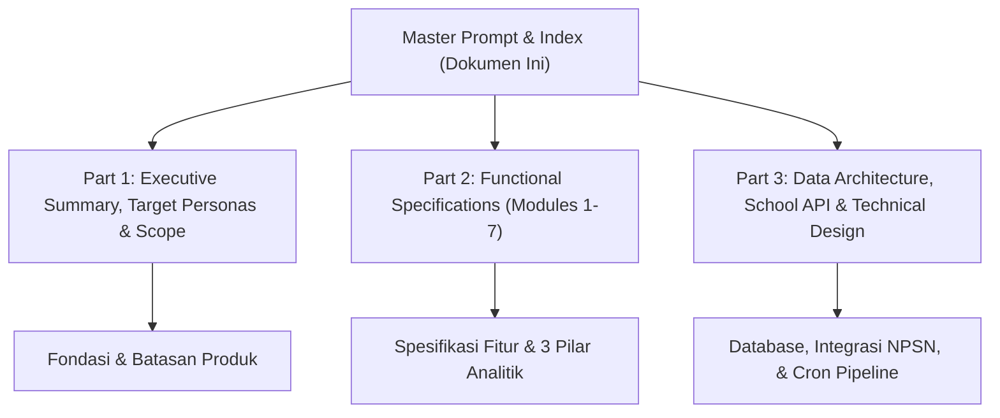

# Master Prompt & PRD Roadmap: AnalyticsDashboard (GameForSmart)

Dokumen ini menyediakan **Master Prompt** (dapat digunakan kembali di AI/LLM untuk re-generasi atau ekspansi teknis) serta **Struktur Panduan (Index)** pembuatan PRD lengkap untuk platform **AnalyticsDashboard GameForSmart**.

Format dan gaya penulisan mengadopsi standar spesifikasi **StarGate - Face Recognition Attendance System PRD**, yang disesuaikan secara komprehensif untuk analitik pendidikan berbasis data game & kuis adaptif.

---

## 1. Master Prompt Siap Pakai (Reusable Prompt)

Salin prompt di bawah ini untuk digunakan pada AI / LLM guna menghasilkan atau mengembangkan PRD secara mendalam:

```markdown
Anda adalah seorang Lead Technical Product Manager dan Enterprise Software Architect kelas dunia. 
Tugas Anda adalah menyusun Product Requirements Document (PRD) yang sangat komprehensif, presisi, dan siap diimplementasikan untuk platform "AnalyticsDashboard - GameForSmart".

Gunakan format standar profesional (seperti PRD StarGate), dengan detail teknis, tabel fungsional, state machine, skema database, API signature, dan matriks hak akses.

### 1. Konteks & Data Source
- Ekosistem Induk: GameForSmart (platform game edukasi dan kuis interaktif).
- Database Existing (Supabase/PostgreSQL):
  * `gameforsmartNewUI`: Tabel `profiles`, `groups`, `quizzes`, `game_sessions`, `learn_sessions`, `reports`, `cities`, `states`, `countries`.
  * `admin_dashboard`: Tabel `user_activities`, `user_notifications`, master game data, audit logs.
- Tech Stack Dashboard: Next.js (App Router, Turbopack), Tailwind CSS v4, shadcn/ui (style New York), Lucide Icons, TypeScript, Supabase SSR.

### 2. Pilar Utama Analitik
1. Deskriptif:
   - Analisa kemampuan siswa per mata pelajaran, tingkat kesulitan, dan topik spesifik.
   - Distribusi akurasi, waktu respon rata-rata, tingkat partisipasi, dan konsistensi belajar.
2. Prediktif:
   - Estimasi skor ujian pada mata pelajaran dan jenjang tertentu (Confidence Interval 95%).
   - Indeks kesiapan ujian (Exam Readiness Score 0-100%) berdasarkan trend historis performa kuis.
3. Preskriptif:
   - Deteksi otomatis materi/kompetensi dasar (KD) yang belum dikuasai (learning gaps).
   - Rekomendasi kuis remedial, materi pengayaan, dan penugasan personal/kelompok.

### 3. Struktur Pengguna & Multi-Level Scoping
- Guru: Mengawasi siswa dalam kelas/grup asuhannya lintas jenjang, memberikan tugas (task), memonitor progres pengerjaan, dan mengevaluasi hasil.
- Pengelola Sekolah (Kepala Sekolah / Admin): Memonitor seluruh kelas dan seluruh jenjang di sekolah bersangkutan, benchmark antarkelas.
- Dinas Pendidikan Kab/Kota: Memonitor seluruh sekolah dalam 1 kabupaten/kota, pemetaan capaian kompetensi dan sekolah unggulan/butuh intervensi.
- Dinas Pendidikan Provinsi: Agregasi data antar kab/kota di bawah provinsi.
- Dinas Pendidikan Nasional: Pemetaan makro capaian pendidikan nasional.

### 4. Fitur & Alur Spesifik
- Login Page: Meniru alur dan UI dari `gameforsmartNewUI` (multi-auth / username & password dengan sesi terintegrasi).
- Master Data Sekolah: Integrasi API Data Pokok Satuan Pendidikan Indonesia yang mendukung pencarian by NPSN, nama, jenjang, kab/kota, provinsi (misal: API Sekolah Indonesia Dapodik / Edge Gateway).
- Student Onboarding ke Group Guru:
  1. Input / Search username murid di GameForSmart.
  2. Scan QR Code profil murid langsung dari aplikasi GameForSmart.
- Data Processing & Snapshot Cache:
  - Data ditarik dari database sesuai peran dan lingkup secara on-demand.
  - Proses analitik dijalankan melalui Analytics/AI Engine API dengan animasi Progress Bar & status langkah analitik real-time.
  - Hasil analitik disimpan dalam format JSON Snapshot di database (`analytics_snapshots`).
  - Saat dashboard dibuka, data terakhir langsung ditampilkan dengan badge "Last Update" dan tombol manual "Refresh / Update Analisa".
  - Scheduled Auto-Sync: Cron worker berjalan otomatis setiap hari pukul 00:00 (12 dini hari) untuk mengagregasi snapshot harian.
- Task Management Guru:
  - Guru dapat membuat penugasan kuis/latihan dengan batas waktu.
  - Pemantauan live submission, evaluasi skor, dan identifikasi siswa siap/belum siap.

Susun PRD ini ke dalam bagian:
1. Executive Summary & Goals
2. User Personas & Permission Matrix
3. Scope of Product (In-Scope & Out-of-Scope V1)
4. Functional Specifications (Module-by-Module)
5. Non-Functional Requirements & Security
6. Database Architecture & Schema Integration
7. API Integration (School Data & Analytics Engine)
8. Technical Architecture & File Structure
9. MVP Success Metrics & Future Roadmap
```

---

## 2. Struktur Dokumen PRD Bertahap (Artifact Index)

Agar penyusunan PRD berjalan mendalam dan terinci tanpa terpotong, PRD dipecah menjadi 3 dokumen artefak spesifikasi teknis berikut:



### Daftar Dokumen PRD:
1. **[Part 1: Executive Summary, Target Personas & Scope](file:///home/alss/.gemini/antigravity/brain/efa07f7f-2ac7-4ddc-bdf9-b8f3c9b86d16/PRD_Part1_Executive_Summary_User_Roles_Scope.md)**:
   - Latar belakang ekosistem GameForSmart.
   - Tujuan bisnis & metrik keberhasilan produk.
   - Segmentasi pengguna & Matriks Hak Akses (Guru, Sekolah, Dinas Kab/Kota, Prov, Nasional).
   - Lingkup Fitur (In Scope vs Out of Scope V1).

2. **[Part 2: Functional Specifications](file:///home/alss/.gemini/antigravity/brain/efa07f7f-2ac7-4ddc-bdf9-b8f3c9b86d16/PRD_Part2_Functional_Specifications.md)**:
   - Modul 1: Autentikasi & Integrasi Akun GameForSmart.
   - Modul 2: Master Data Satuan Pendidikan (Pencarian NPSN & Hirarki Wilayah).
   - Modul 3: Manajemen Grup & Student Onboarding (Username & Scan QR).
   - Modul 4: Manajemen Tugas Guru & Evaluasi Progres Siswa.
   - Modul 5: Tiga Pilar Analitik (Deskriptif, Prediktif, Preskriptif).
   - Modul 6: Analytics Processing Pipeline, Progress Bar, JSON Snapshot & Cron Pukul 00:00.
   - Modul 7: Multi-Level Monitoring Dashboard (Hierarkis).

3. **[Part 3: Data Architecture, School API & Technical Design](file:///home/alss/.gemini/antigravity/brain/efa07f7f-2ac7-4ddc-bdf9-b8f3c9b86d16/PRD_Part3_Data_Architecture_API_and_Technical_Design.md)**:
   - Pemetaan skema database Supabase existing (`profiles`, `game_sessions`, `learn_sessions`, `quizzes`) ke skema analitik baru.
   - Skema tabel baru: `schools`, `academic_groups`, `group_students`, `student_tasks`, `task_submissions`, `analytics_snapshots`.
   - Spesifikasi API Sekolah Indonesia & fallback handling.
   - Non-Functional Requirements, Security, Audit Logging, & Tech Stack Deployment.
