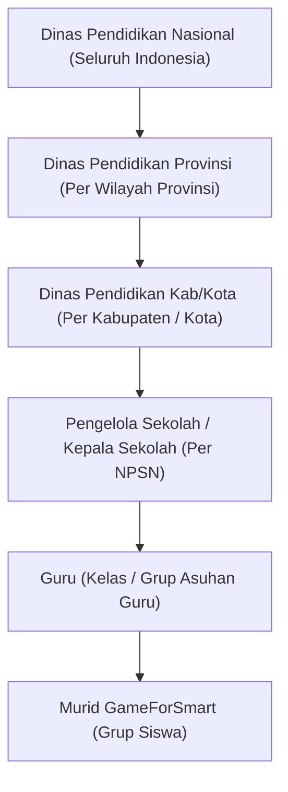

# Product Requirements Document (PRD)
## GameForSmart - AnalyticsDashboard (Educational Intelligence & Monitoring Platform)

**Version:** 1.0  
**Product Name:** GameForSmart AnalyticsDashboard  
**Platform:** Web Application (Responsive Desktop & Tablet-First)  
**Target Users:** Guru, Pengelola Sekolah, Dinas Pendidikan Kab/Kota, Dinas Pendidikan Provinsi, Dinas Pendidikan Nasional  
**Technology Stack:** Next.js 16 (App Router, Turbopack), Tailwind CSS v4, shadcn/ui, TypeScript, Supabase (PostgreSQL), Redis/Cron Worker  

---

## 1. Executive Summary

### 1.1 Latar Belakang
Platform **GameForSmart** telah berhasil menghadirkan lingkungan belajar yang interaktif melalui gamifikasi kuis, kompetisi kuis berjenjang, dan sesi belajar mandiri (`learn_sessions` & `game_sessions`). Setiap sesi interaksi siswa menghasilkan jejak data yang sangat kaya: pola jawaban, tingkat ketelitian, kecepatan merespon (response time), tingkat kesulitan soal yang ditaklukkan, serta riwayat repetisi kuis.

Meskipun demikian, data berharga tersebut selama ini masih terisolasi di sisi operasional game dan admin umum (`gameforsmartNewUI` dan `admin_dashboard`), tanpa adanya agregasi analitik yang dapat langsung dimanfaatkan oleh stakeholder pendidikan:
- **Guru** kesulitan memetakan siswa mana yang belum menguasai indikator pembelajaran tertentu dan membutuhkan bimbingan khusus.
- **Pengelola Sekolah** tidak memiliki alat ukur objektif untuk membandingkan kesiapan akademik antarkelas dalam menghadapi ujian resmi.
- **Dinas Pendidikan (Kabupaten/Kota, Provinsi, dan Nasional)** tidak memiliki data real-time berbasis bukti (*evidence-based policy*) untuk melihat sekolah mana yang telah mencapai target kompetensi nasional atau yang memerlukan intervensi bantuan kurikulum.

**GameForSmart AnalyticsDashboard** hadir sebagai solusi intelijen pendidikan (*Educational Intelligence System*) yang mengolah big data interaksi kuis menjadi wawasan komprehensif melalui tiga pilar analitik: **Deskriptif**, **Prediktif**, dan **Preskriptif**.

---

## 2. Tujuan Produk (Product Objectives)

### 2.1 Tujuan Utama
1. **Analisa Kemampuan Siswa Multi-Dimensi (Deskriptif):** Memberikan gambaran akurat mengenai profil penguasaan mata pelajaran per siswa, per kelas, dan per sekolah.
2. **Estimasi Kesiapan Ujian (Prediktif):** Memprediksi potensi capaian skor ujian akhir/nasional siswa pada mata pelajaran tertentu berdasarkan trend historis data kuis, lengkap dengan tingkat kesiapannya (*Readiness Index*).
3. **Penyembuhan Kesenjangan Belajar (Preskriptif):** Menemukan topik atau indikator kompetensi dasar yang belum tuntas (*learning gap*) dan memberikan rekomendasi penugasan/remedial terarah.
4. **Sentralisasi Hierarki Pendidikan:** Menghubungkan guru, pimpinan sekolah, hingga pengawas dinas pendidikan dalam satu ekosistem data yang terpadu berdasarkan Nomor Pokok Sekolah Nasional (NPSN).
5. **Aksi Nyata Pengajaran:** Menyediakan kanal penugasan tugas (*Task Assignment*) dari guru langsung ke murid dengan tracking pengerjaan real-time.

### 2.2 Indikator Keberhasilan (KPI)
- **Akurasi Prediksi Ujian:** Korelasi hasil prediksi skor dengan capaian riil siswa mencapai $\ge 85\%$.
- **Adopsi Guru:** Guru aktif membuat grup pengawasan dan memberikan minimal 2 penugasan per bulan $\ge 70\%$.
- **Kecepatan Akses Analitik:** Waktu load dasbor analitik cached $< 1.5$ detik; waktu pemrosesan analitik batch $< 15$ detik dengan live progress feedback.
- **Cakupan Sekolah:** Terkoneksi dengan direktori NPSN nasional untuk pemetaan otomatis di tingkat daerah.

---

## 3. User Personas & Hierarki Peran

Platform dirancang dengan hierarki akses berjenjang (*Hierarchical Role-Based Access Control* / HRBAC) sebagai berikut:

### 3.1 Profil Peran Pengguna

| Peran | Profil & Tanggung Jawab | Cakupan Pengawasan (Scope) |
| :--- | :--- | :--- |
| **Guru (Teacher)** | Pendidik di sekolah yang membina satu atau beberapa kelas pada jenjang/tingkat tertentu. Membutuhkan detail per individu siswa. | Grup/kelas asuhan guru tersebut (dapat lintas jenjang/tingkat sesuai penugasan mengajar). |
| **Pengelola Sekolah (School Admin / Principal)** | Kepala Sekolah, Wakil Kepala Kurikulum, atau Admin IT Sekolah yang memantau kualitas institusi. | Seluruh kelas, seluruh jenjang, dan seluruh guru di dalam satuan pendidikan (NPSN) yang dikelolanya. |
| **Dinas Pendidikan Kab/Kota** | Pejabat dinas tingkat kabupaten/kota (misal: Disdik Kota Surabaya). Memantau jenjang PAUD/TK, SD, SMP di daerahnya. | Seluruh sekolah (NPSN) yang berada dalam yurisdiksi kabupaten/kota terkait. |
| **Dinas Pendidikan Provinsi** | Pejabat dinas tingkat provinsi (misal: Disdik Jawa Timur). Memantau jenjang SMA, SMK, dan SLB. | Seluruh kabupaten/kota dan seluruh sekolah tingkat menengah di provinsi terkait. |
| **Dinas Pendidikan Nasional** | Kementerian Pendidikan Dasar dan Menengah (Kemendikdasmen). Analisis makro mutu pendidikan nasional. | Agregasi nasional seluruh provinsi, kabupaten/kota, dan sekolah di Indonesia. |

### 3.2 Permission Matrix (Matriks Hak Akses)

| Modul / Fitur | Guru | Pengelola Sekolah | Dinas Kab/Kota | Dinas Provinsi | Dinas Nasional |
| :--- | :---: | :---: | :---: | :---: | :---: |
| **Login & Profil** | Semua | Semua | Semua | Semua | Semua |
| **Cari & Klaim NPSN Sekolah** | Terikat Akun | Admin Utama | View Regional | View Regional | View Nasional |
| **Bentuk Grup Pengawasan** | Buat/Ubah | Kelola Semua | Hanya Baca | Hanya Baca | Hanya Baca |
| **Tambah Murid via Username / QR** | Ya | Ya | Tidak | Tidak | Tidak |
| **Berikan Task / Tugas ke Murid** | Ya | Tidak | Tidak | Tidak | Tidak |
| **Evaluasi Progres Tugas** | Ya | Monitoring | Tidak | Tidak | Tidak |
| **Analitik Deskriptif Siswa (Individu)** | Ya | Ya (Sekolah) | Anonymized | Anonymized | Anonymized |
| **Analitik Prediktif (Skor & Kesiapan)** | Kelas Guru | Semua Kelas | Agregat Sekolah | Agregat Kab/Kota | Agregat Provinsi |
| **Analitik Preskriptif (Gap Materi)** | Kelas Guru | Semua Kelas | Trend Wilayah | Trend Wilayah | Trend Nasional |
| **Trigger Update Analisis (On-Demand)** | Ya (Grupnya) | Ya (Sekolah) | Ya (Wilayah) | Ya (Wilayah) | Ya (Nasional) |
| **Export Laporan (PDF / Excel)** | Ya | Ya | Ya | Ya | Ya |

---

## 4. Scope of Product

### 4.1 In Scope (Fase 1 / MVP)
- **Sistem Autentikasi Terpadu:** Mekanisme login identik dengan UI GameForSmart, mendukung autentikasi guru, kepala sekolah, dan staf dinas.
- **Integrasi Master Data NPSN:** Pencarian instan database sekolah seluruh Indonesia berdasarkan NPSN dan wilayah (Provinsi, Kab/Kota, Kecamatan) via API Satuan Pendidikan.
- **Grup & Onboarding Murid:**
  - Pembuatan grup/kelas pengawasan oleh guru.
  - Penambahan murid via input username GameForSmart.
  - Penambahan murid via pemindaian (Scan) QR Code profil GameForSmart murid menggunakan kamera web/perangkat.
- **Manajemen Task / Penugasan:**
  - Pembuatan tugas kuis materi spesifik dengan deadline.
  - Pelacakan status pengerjaan (Belum Mengerjakan, Sedang Berlangsung, Selesai).
  - Evaluasi nilai dan akurasi per tugas.
- **Mesin Analitik 3 Pilar:**
  - *Deskriptif:* Penguasaan per mapel, akurasi, waktu respon, konsistensi belajar.
  - *Prediktif:* Estimasi nilai ujian (0-100) dan indeks kesiapan (Tinggi, Sedang, Perlu Pendampingan).
  - *Preskriptif:* Pemetaan indikator kompetensi yang belum tercapai (Learning Gaps) + rekomendasi aksi.
- **Pipeline Snapshot & Caching:**
  - Live progress bar saat data ditarik dan dihitung via Analytics Engine API.
  - Penyimpanan hasil analisis dalam bentuk JSON Snapshot.
  - Penanda waktu *Last Update* dan tombol *Trigger Update Manual*.
  - Pembaruan otomatis terjadwal (Cron Job) setiap pukul 00:00 (tengah malam).
- **Dasbor Berjenjang Sesuai Peran:** Tampilan analitik dinamis mengikuti cakupan Guru, Sekolah, dan Dinas.

### 4.2 Out of Scope (Batasan Sistem)
- **Pembuatan & Editor Kuis Baru:** Pembuatan soal, media pertanyaan, dan materi kuis tetap dilakukan di aplikasi GameForSmart (`gameforsmartNewUI`), dasbor ini murni memilih kuis yang telah tersedia untuk penugasan.
- **Gameplay / Pengerjaan Kuis Siswa:** Siswa memainkan game kuis dan sesi latihan langsung di aplikasi GameForSmart, dasbor ini hanya mengumpulkan data histori dan mengevaluasi hasil pengerjaan.
- **Manajemen Akun Siswa & Gamifikasi:** Pengelolaan profil siswa, avatar store, inventory item, dan XP/koin dilakukan di aplikasi GameForSmart murid.
- **Aplikasi Mobile Terpisah:** Fokus dasbor adalah Web Responsive (Desktop & Tablet) untuk kemudahan analisis visual data bagi guru, kepala sekolah, dan dinas.
