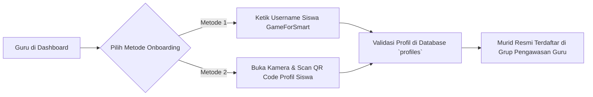
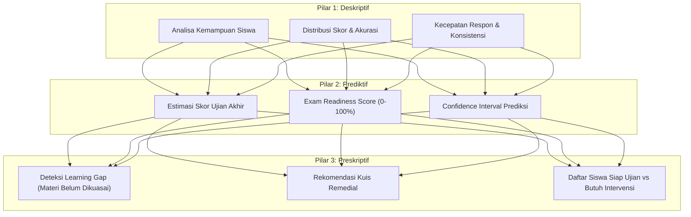
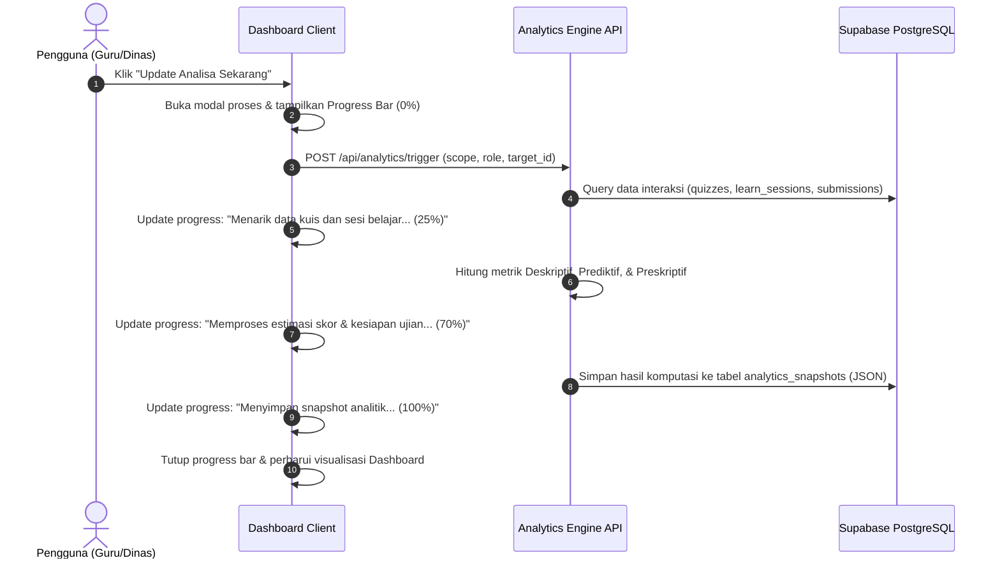

# Product Requirements Document (PRD) - Bagian 2
## Spesifikasi Fungsional Modul (Module Specifications)

Dokumen ini menjabarkan rincian teknis setiap modul fungsional dalam platform **GameForSmart AnalyticsDashboard**.

---

## Modul 1: Autentikasi & Akun Pengguna

### 1.1 Deskripsi
Menyediakan gerbang masuk yang aman dan terintegrasi dengan akun GameForSmart. Tampilan dan alur login mengadopsi struktur visual dan kenyamanan UI dari `gameforsmartNewUI`.

### 1.2 Alur & Fitur
- **Login Antarmuka:**
  - Input: `Username / Email` dan `Password`.
  - Opsi *Remember Me* (Token Refresh Session tersimpan di HTTP-only cookie).
  - Tautan Lupa Password terhubung dengan sistem recovery email GameForSmart.
- **Role Detection & Redirection:**
  - Setelah login berhasil, sistem membaca tabel profil dan hak peran (`role`):
    - Jika `guru`: langsung diarahkan ke `/dashboard/teacher`.
    - Jika `pengelola_sekolah`: diarahkan ke `/dashboard/school`.
    - Jika `dinas_kabkota` / `dinas_provinsi` / `dinas_nasional`: diarahkan ke `/dashboard/dinas`.
- **Integrasi Single Sign-On (SSO):** Sesi pengguna disinkronkan dengan sesi aktif GameForSmart via cookie domain bersama (`.gameforsmart.com`).

---

## Modul 2: Master Data Sekolah & Pencarian NPSN

### 2.1 Deskripsi
Menghubungkan data pengguna dan analitik dengan satuan pendidikan resmi di Indonesia. Mengingat database lokal belum memiliki master sekolah lengkap, modul ini memanfaatkan **API Data Sekolah Indonesia / Dapodik Gateway**.

### 2.2 Fitur & Spesifikasi Teknis
- **Search by NPSN (Nomor Pokok Sekolah Nasional):**
  - Input 8 digit NPSN (misal: `20101490` atau nama sekolah "SMAN 1").
  - Sistem melakukan debounce call (300ms) ke endpoint API pencarian.
  - Menampilkan hasil autocomplete: Nama Sekolah, NPSN, Jenjang (SD/SMP/SMA/SMK), Status (Negeri/Swasta), Alamat, Kecamatan, Kabupaten/Kota, Provinsi.
- **Hirarki Wilayah:**
  - Pemilihan berjenjang: `Provinsi` $\rightarrow$ `Kabupaten / Kota` $\rightarrow$ `Kecamatan` $\rightarrow$ `Sekolah (NPSN)`.
- **Caching Master Sekolah:**
  - Setiap sekolah yang telah dipilih atau diklaim oleh guru/admin disimpan ke tabel lokal `schools` di PostgreSQL agar tidak membebani query API publik di masa mendatang.

---

## Modul 3: Manajemen Grup & Student Onboarding

### 3.1 Deskripsi
Guru dapat mengelompokkan siswa ke dalam kelas/grup asuhan pengawasannya untuk memudahkan penugasan materi dan pemantauan analitik terfokus.

### 3.2 Metode Penambahan Murid ke Grup
Guru memiliki 2 metode instan untuk memasukkan siswa ke dalam grup:



1. **Metode 1: Ketik Username (Manual Input / Search):**
   - Guru mengetik username siswa GameForSmart.
   - Sistem menampilkan kartu pratinjau siswa (Avatar, Fullname, Grade/Tingkat, Username).
   - Guru menekan tombol **"Tambahkan ke Grup"**.
2. **Metode 2: Scan QR Code Profil GameForSmart (Camera Scanner):**
   - Siswa membuka profil akun di aplikasi GameForSmart yang menampilkan kartu QR profil uniknya (berisi `gfs:student:<profile_id>:<username>`).
   - Guru menekan tombol **"Scan QR Murid"** di AnalyticsDashboard.
   - Kamera perangkat (laptop/webcam/tablet) aktif dengan overlay frame scanner persegi.
   - Begitu QR terdeteksi ($< 500\text{ ms}$), sistem memvalidasi `profile_id`, memainkan audio konfirmasi (*beep success*), dan langsung memasukkan siswa ke grup secara instan.

### 3.3 Struktur Data Grup
- Guru dapat membuat beberapa grup sekaligus dari berbagai jenjang/tingkat (misal: "Kelas 10-A Matematika", "Kelas 11-IPA 2 Fisika", "Kelas 12 UTBK Persiapan").

---

## Modul 4: Manajemen Tugas (Task Assignment) & Evaluasi Progres

### 4.1 Deskripsi
Menjadikan dasbor bukan hanya sekadar sarana pengamatan pasif, melainkan alat aksi pengajaran langsung. Guru dapat menugaskan paket kuis/materi kepada grup siswa tertentu.

### 4.2 Fitur Penugasan
- **Create Task:**
  - Judul Penugasan & Deskripsi Instruksi.
  - Pemilihan Kuis/Materi dari bank kuis GameForSmart (filter mapel, topik, jenjang).
  - Target Grup Siswa (bisa satu atau banyak grup).
  - Batas Waktu Penyelesaian (Deadline) & Durasi Pengerjaan.
- **Monitoring Progres Real-Time:**
  - Indikator Status: `Belum Membuka` (Abu-abu), `Sedang Mengerjakan` (Kuning), `Selesai` (Hijau), `Terlambat` (Merah).
  - Progress Bar persentase pengerjaan kuis per siswa.
- **Evaluasi Hasil:**
  - Skor akhir, akurasi per sub-indikator soal, waktu rata-rata per pertanyaan.
  - Fitur **"Highlight Siswa Unggul & Perlu Bimbingan"**: Otomatis menandai siswa yang sudah melampaui KKM (>85%) dan siswa yang memerlukan remedial (<65%).

---

## Modul 5: Mesin Analitik Dashboard (3 Pilar Inteligensi)

Ini merupakan modul inti (*core engine*) dari AnalyticsDashboard GameForSmart.



### 5.1 Pilar 1: Analitik Deskriptif (Historical Mastery Analysis)
- **Kompetensi Mapel & Jenjang:** Mengukur rata-rata pemahaman siswa pada mata pelajaran tertentu di jenjangnya (misal: Matematika Kelas 10).
- **Matriks Kemampuan Siswa:**
  - *Accuracy Rate (%):* Rasio jawaban benar terhadap seluruh soal yang pernah dikerjakan.
  - *Speed Index (detik/soal):* Kecepatan siswa dalam mencerna dan memecahkan masalah.
  - *Difficulty Resilience:* Seberapa sering siswa mampu menjawab benar soal berlabel *Hard* atau *HOTS* (*Higher Order Thinking Skills*).
  - *Learning Momentum:* Frekuensi latihan dalam 14 hari terakhir.

### 5.2 Pilar 2: Analitik Prediktif (Exam Estimation & Readiness)
- **Estimasi Skor Ujian (Exam Score Forecast):**
  - Mengkalkulasikan estimasi perolehan nilai siswa pada ujian standar mapel tertentu dalam rentang skala 0 – 100 dengan batas toleransi error ($\pm 5$ poin).
  - Model estimasi mempertimbangkan bobot kesulitan soal, riwayat penurunan/kenaikan skor, dan konsistensi penyelesaian.
- **Indeks Kesiapan Ujian (Exam Readiness Index):**
  - Kategori:
    - **Sangat Siap ($\ge 85\%$):** Penguasaan materi merata, akurasi tinggi pada soal level sedang dan sulit.
    - **Cukup Siap ($70\% - 84\%$):** Menguasai materi dasar, namun masih inkonsisten pada topik kompleks.
    - **Perlu Pendampingan ($< 70\%$):** Terdapat kesenjangan pemahaman substansial pada topik prasyarat.

### 5.3 Pilar 3: Analitik Preskriptif (Learning Gap & Remedial Action)
- **Deteksi Materi Belum Dikuasai (*Unmastered Competencies*):**
  - Sistem mengurai setiap soal ke dalam tag kompetensi (misal: *Aljabar*, *Trigonometri*, *Hukum Newton*).
  - Mendeteksi materi mana yang akurasi kumulatifnya berada di bawah standar ketuntasan minimum ($\text{Akurasi} < 65\%$).
- **Rekomendasi Preskriptif untuk Guru:**
  - Tombol aksi **"Tugaskan Remedial untuk Materi Ini"**: Guru cukup mengklik 1 tombol untuk otomatis membuat penugasan kuis relevan hanya kepada siswa-siswa yang terdeteksi memiliki gap pada topik tersebut.
  - Daftar siswa yang direkomendasikan untuk bimbingan kelompok kecil (*peer tutoring*).

---

## Modul 6: Analytics Processing Pipeline, Progress Bar, & JSON Snapshot

### 6.1 Alur Pemrosesan On-Demand (On-Demand Processing)
Saat pengguna (guru, sekolah, dinas) meminta pembaruan analisa secara manual, sistem tidak langsung memblokir UI, melainkan menjalankan proses asinkron dengan visualisasi interaktif:



### 6.2 Penyimpanan JSON Snapshot
Hasil analisa disimpan dalam kolom bertipe `jsonb` pada tabel `analytics_snapshots`. Format data JSON memuat seluruh agregasi:
```json
{
  "summary": {
    "total_students": 32,
    "average_mastery": 78.4,
    "predicted_exam_avg": 81.2,
    "readiness_distribution": { "ready": 18, "moderate": 10, "needs_help": 4 }
  },
  "subject_analysis": [
    {
      "subject": "Matematika",
      "grade": "10",
      "accuracy": 76.5,
      "unmastered_topics": ["Trigonometri Dasar", "Fungsi Kuadrat"],
      "top_performers": ["alss_dev", "budi_smart"],
      "struggling_students": ["citra_99", "dani_k"]
    }
  ],
  "student_details": [
    {
      "profile_id": "uuid-001",
      "username": "citra_99",
      "predicted_score": 62.0,
      "readiness_status": "needs_help",
      "gap_topics": ["Trigonometri Dasar"]
    }
  ]
}
```

### 6.3 State & Komponen UI Snapshot
- **Badge Last Update:** Menampilkan informasi waktu terakhir analisa dihitung, contoh: *"Terakhir diperbarui: Hari ini pukul 08:30 WIB"*.
- **Tombol "Update Analisa":** Memungkinkan pembaruan data terkini secara manual jika ada aktivitas pengerjaan kuis terbaru.
- **Pembaruan Otomatis Terjadwal (Cron Job 00:00 / Tengah Malam):**
  - Background worker berjalan otomatis setiap hari pada pukul **00:00 WIB**.
  - Mengagregasi seluruh aktivitas siswa pada hari tersebut dan menyegarkan JSON snapshot untuk setiap grup, sekolah, dan wilayah dinas.
  - Menjamin saat pengguna membuka dashboard di pagi hari, data sudah terbarukan tanpa perlu menunggu proses hitung ulang.

---

## Modul 7: Tampilan Monitoring Berjenjang (Hierarchical Views)

Tampilan dashboard secara otomatis beradaptasi dengan peran pengguna:

### 7.1 View Guru (Classroom Scope)
- Widget pemilihan grup/kelas aktif.
- Visualisasi skor prediksi rata-rata kelas vs target kelulusan.
- Grid siswa: kartu profil siswa dengan tag kesiapan (Hijau: Siap, Kuning: Cukup, Merah: Butuh Bimbingan).
- Daftar Top 3 materi yang paling banyak dijawab salah oleh siswa kelas tersebut.

### 7.2 View Pengelola Sekolah (School Scope)
- Perbandingan performa antarkelas dalam satu jenjang (misal: perbandingan Kelas 10-A vs 10-B vs 10-C).
- Identifikasi guru/kelas dengan tingkat ketuntasan kompetensi tertinggi.
- Grafik korelasi partisipasi kuis harian terhadap tren prediksi skor ujian sekolah.

### 7.3 View Dinas Pendidikan (Regional Scope)
- **Dinas Kab/Kota:** Peta sebaran mutu sekolah di kabupaten/kota. Indikator sekolah hijau (target tercapai) dan sekolah merah (membutuhkan asistensi kurikulum).
- **Dinas Provinsi:** Peringkat agregat kab/kota di bawah naungan provinsi berdasarkan rata-rata indeks kesiapan ujian tingkat SMA/SMK.
- **Dinas Nasional:** Komparasi makro capaian standar kompetensi lintas provinsi di seluruh Indonesia.
