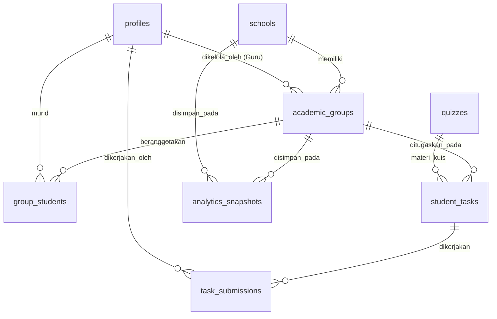

# Product Requirements Document (PRD) - Bagian 3
## Arsitektur Data, Integrasi API, & Desain Teknis

Dokumen ini memuat spesifikasi teknis tingkat lanjut mengenai perancangan skema database, integrasi API eksternal (Master Sekolah NPSN & Analytics Engine), keamanan, arsitektur sistem, dan struktur direktori proyek **AnalyticsDashboard**.

---

## 1. Desain Skema Database (Database Design)

Arsitektur database mengadopsi integrasi langsung dengan PostgreSQL/Supabase yang sudah ada di ekosistem GameForSmart (`gameforsmartNewUI` dan `admin_dashboard`), serta menambahkan tabel-tabel ekstensi untuk fitur analitik dan manajemen akademik.



### 1.1 Pemetaan Tabel Existing yang Digunakan
1. **`profiles` (GameForSmart):**
   - Kolom utama: `id`, `auth_user_id`, `email`, `fullname`, `avatar_url`, `grade`, `city_id`, `country_id`.
   - Peran: Identitas utama siswa dan pendidik.
2. **`quizzes` (GameForSmart):**
   - Kolom utama: `id`, `category`, `grade`, `description`, `is_public`.
   - Peran: Sumber bank soal/materi kuis untuk penugasan (*Task Assignment*).
3. **`learn_sessions` & `game_sessions` (GameForSmart):**
   - Kolom utama: `id`, `user_id`, `quiz_id`, `responses` (JSON log jawaban), `total_time_minutes`, `status`.
   - Peran: Sumber data mentah interaksi untuk kalkulasi analitik deskriptif, prediktif, dan preskriptif.
4. **`user_activities` (admin_dashboard):**
   - Kolom utama: `id`, `user_id`, `activity_type`, `created_at`.
   - Peran: Pelacakan frekuensi keterlibatan belajar siswa.

### 1.2 Skema Tabel Baru (Analytics & Academic Extension)

#### 1. Tabel `schools` (Data Master Satuan Pendidikan)
```sql
CREATE TABLE schools (
    npsn VARCHAR(10) PRIMARY KEY,
    name VARCHAR(255) NOT NULL,
    education_level VARCHAR(20) NOT NULL, -- TK, SD, SMP, SMA, SMK
    status VARCHAR(10) NOT NULL,          -- Negeri, Swasta
    province VARCHAR(100) NOT NULL,
    city VARCHAR(100) NOT NULL,
    district VARCHAR(100) NOT NULL,
    address TEXT,
    created_at TIMESTAMPTZ DEFAULT NOW(),
    updated_at TIMESTAMPTZ DEFAULT NOW()
);
```

#### 2. Tabel `academic_groups` (Grup Pengawasan Guru)
```sql
CREATE TABLE academic_groups (
    id UUID PRIMARY KEY DEFAULT gen_random_uuid(),
    teacher_id UUID NOT NULL REFERENCES profiles(id) ON DELETE CASCADE,
    school_npsn VARCHAR(10) REFERENCES schools(npsn),
    name VARCHAR(150) NOT NULL,           -- Misal: "Kelas 10-A Matematika"
    grade VARCHAR(20) NOT NULL,          -- Jenjang / Tingkat
    subject VARCHAR(100) NOT NULL,        -- Mata Pelajaran
    academic_year VARCHAR(20) NOT NULL,   -- Misal: "2026/2027"
    created_at TIMESTAMPTZ DEFAULT NOW(),
    updated_at TIMESTAMPTZ DEFAULT NOW()
);
```

#### 3. Tabel `group_students` (Daftar Siswa dalam Grup)
```sql
CREATE TABLE group_students (
    id UUID PRIMARY KEY DEFAULT gen_random_uuid(),
    group_id UUID NOT NULL REFERENCES academic_groups(id) ON DELETE CASCADE,
    student_id UUID NOT NULL REFERENCES profiles(id) ON DELETE CASCADE,
    joined_method VARCHAR(20) NOT NULL,   -- 'username' ATAU 'qr_scan'
    joined_at TIMESTAMPTZ DEFAULT NOW(),
    UNIQUE(group_id, student_id)
);
```

#### 4. Tabel `student_tasks` (Penugasan dari Guru)
```sql
CREATE TABLE student_tasks (
    id UUID PRIMARY KEY DEFAULT gen_random_uuid(),
    teacher_id UUID NOT NULL REFERENCES profiles(id),
    group_id UUID NOT NULL REFERENCES academic_groups(id) ON DELETE CASCADE,
    quiz_id UUID NOT NULL REFERENCES quizzes(id),
    title VARCHAR(200) NOT NULL,
    instructions TEXT,
    deadline TIMESTAMPTZ NOT NULL,
    created_at TIMESTAMPTZ DEFAULT NOW()
);
```

#### 5. Tabel `task_submissions` (Hasil Pengerjaan Tugas)
```sql
CREATE TABLE task_submissions (
    id UUID PRIMARY KEY DEFAULT gen_random_uuid(),
    task_id UUID NOT NULL REFERENCES student_tasks(id) ON DELETE CASCADE,
    student_id UUID NOT NULL REFERENCES profiles(id),
    learn_session_id UUID REFERENCES learn_sessions(id),
    score NUMERIC(5,2) DEFAULT 0,
    accuracy NUMERIC(5,2) DEFAULT 0,
    duration_seconds INT DEFAULT 0,
    status VARCHAR(20) DEFAULT 'submitted', -- 'in_progress', 'submitted', 'late'
    submitted_at TIMESTAMPTZ DEFAULT NOW()
);
```

#### 6. Tabel `analytics_snapshots` (Penyimpanan JSON Hasil Analisis)
```sql
CREATE TABLE analytics_snapshots (
    id UUID PRIMARY KEY DEFAULT gen_random_uuid(),
    scope_level VARCHAR(20) NOT NULL,     -- 'group', 'school', 'city', 'province', 'national'
    scope_id VARCHAR(100) NOT NULL,       -- group_id, school_npsn, kode_wilayah
    trigger_type VARCHAR(20) NOT NULL,    -- 'manual_user', 'scheduled_cron'
    data_snapshot JSONB NOT NULL,         -- JSON agregat analitik lengkap
    metrics_summary JSONB,                -- Ringkasan cepat metrik (avg score, readiness)
    generated_by UUID REFERENCES profiles(id),
    created_at TIMESTAMPTZ DEFAULT NOW()
);
CREATE INDEX idx_analytics_snapshots_lookup 
ON analytics_snapshots (scope_level, scope_id, created_at DESC);
```

---

## 2. Integrasi API Data Sekolah Indonesia (NPSN Search API)

Untuk mengakomodasi kebutuhan pencarian data sekolah seluruh Indonesia berdasarkan NPSN dan wilayah:

### 2.1 Pilihan API Provider Rekomendasi
1. **API Sekolah Indonesia (`api-sekolah-indonesia.vercel.app` / Dapodik Gateway):**
   - **Fitur:** Pencarian by NPSN, nama sekolah, jenjang (SD/SMP/SMA/SMK), dan filter wilayah (provinsi, kabupaten/kota, kecamatan).
   - **Endpoint Pencarian:**
     ```http
     GET https://api-sekolah-indonesia.vercel.app/sekolah/s?sekolah={query}
     GET https://api-sekolah-indonesia.vercel.app/sekolah?npsn={npsn}
     GET https://api-sekolah-indonesia.vercel.app/sekolah/{jenjang}?page={page}&perPage={perPage}
     ```
   - **Skema Output JSON:**
     ```json
     {
       "status": "success",
       "dataSekolah": [
         {
           "id": "uuid",
           "sekolah": "SMAN 1 SURABAYA",
           "npsn": "20532247",
           "bentuk": "SMA",
           "status": "NEGERI",
           "alamat_jalan": "Jl. Wijaya Kusuma No. 48",
           "kecamatan": "Kec. Genteng",
           "kabupaten_kota": "Kota Surabaya",
           "propinsi": "Prov. Jawa Timur"
         }
       ]
     }
     ```
2. **Arsitektur Caching & Fallback Lokal (Proxy Route):**
   - Panggilan dari client diarahkan ke API route internal: `GET /api/schools/search?q={query}`.
   - Next.js server terlebih dahulu mencari di tabel database lokal `schools`.
   - Jika belum ada di lokal, server memanggil API Sekolah Indonesia, mengembalikan data ke client, dan secara otomatis menyimpannya ke tabel `schools` (*cache-aside pattern*).

---

## 3. Spesifikasi API Pemrosesan Analitik & Cron Job

### 3.1 Endpoint Trigger Analitik Asinkron
- **`POST /api/analytics/trigger`**:
  - Request Body:
    ```json
    {
      "scope_level": "group",
      "scope_id": "8b9a1179-843e-4b47-b5b5-f123456789ab",
      "subject": "Matematika",
      "grade": "10"
    }
    ```
  - Response:
    ```json
    {
      "job_id": "job-an-9921",
      "status": "processing",
      "estimated_duration_seconds": 6
    }
    ```
- **`GET /api/analytics/progress?job_id={job_id}`** (atau via Server-Sent Events / SSE):
  - Mengalirkan progres kalkulasi (0% $\rightarrow$ 25% $\rightarrow$ 70% $\rightarrow$ 100%) langsung ke UI Progress Bar.

### 3.2 Scheduled Midnight Cron Worker (Jam 00:00 WIB)
- Dijalankan via **Next.js Cron Handler** (`/api/cron/daily-analytics`) yang dipicu oleh Vercel Cron / Supabase Scheduled Functions / Linux Cron daemon.
- **Workflow:**
  1. Mengidentifikasi seluruh grup belajar aktif dan satuan pendidikan dengan aktivitas pengerjaan kuis pada 24 jam terakhir.
  2. Menjalankan agregasi batch analitik Deskriptif, Prediktif, dan Preskriptif.
  3. Memasukkan rekaman baru ke `analytics_snapshots` dengan `trigger_type: 'scheduled_cron'`.
  4. Membersihkan snapshot usang yang berusia lebih dari 90 hari.

---

## 4. Non-Functional Requirements (NFR)

### 4.1 Performa
- **Pemuatan Dashboard (Cached):** $\le 1.5$ detik dengan memprioritaskan penyajian data dari snapshot JSON terakhir.
- **Waktu Pemrosesan Analisis On-Demand:** $\le 15$ detik untuk grup hingga 100 siswa, dengan update progress visual setiap tahapan.
- **Pencarian Autocomplete NPSN:** Response time $\le 300\text{ ms}$ dengan integrasi caching lokal.

### 4.2 Keamanan & Akses Data
- **Row-Level Security (RLS) PostgreSQL:**
  - Guru hanya memiliki akses baca/tulis ke grup dan penugasan yang dibuat oleh ID miliknya.
  - Pengelola Sekolah hanya memiliki akses ke grup yang terdaftar pada NPSN sekolahnya.
  - Dinas Pendidikan hanya dapat melihat agregasi statistik anonim sekolah di yurisdiksi terdaftarnya.
- **Proteksi API:** Rate limiting per token pengguna (maksimum 5 kali manual update per jam untuk mencegah lonjakan beban komputasi database).

---

## 5. Struktur Direktori Proyek (`AnalyticsDashboard`)

Proyek dibangun di atas fondasi Next.js 16 dan library shadcn/ui yang telah diselaraskan dengan `gameforsmartNewUI`:

```
AnalyticsDashboard/
├── app/
│   ├── (auth)/
│   │   └── login/                 # Halaman login identik GameForSmart
│   ├── (dashboard)/
│   │   ├── layout.tsx             # Layout terpadu (Header + AppSidebar)
│   │   ├── teacher/               # View Khusus Guru (Grup, Task, Siswa)
│   │   │   ├── groups/
│   │   │   ├── tasks/
│   │   │   └── page.tsx
│   │   ├── school/                # View Pengelola Sekolah (Antarkelas)
│   │   │   └── page.tsx
│   │   └── dinas/                 # View Dinas Kab/Kota, Prov, Nasional
│   │       └── page.tsx
│   ├── api/
│   │   ├── analytics/
│   │   │   ├── trigger/route.ts
│   │   │   └── progress/route.ts
│   │   ├── cron/
│   │   │   └── daily-analytics/route.ts
│   │   └── schools/
│   │       └── search/route.ts    # Search NPSN proxy API
│   ├── globals.css                # CSS variables & shadcn styles
│   └── themes.css                 # Theme presets
├── components/
│   ├── ui/                        # Koleksi 60+ komponen shadcn UI lengkap
│   ├── analytics/                 # Komponen grafik & pilar analitik
│   │   ├── descriptive-card.tsx
│   │   ├── predictive-gauge.tsx
│   │   ├── prescriptive-table.tsx
│   │   └── processing-progress.tsx
│   ├── onboarding/                # Student QR Scanner & Username Input
│   │   ├── qr-scanner-dialog.tsx
│   │   └── username-onboard.tsx
│   ├── layout/                    # Header, AppSidebar, NavMain, UserMenu
│   └── theme-customizer/          # Customizer tema visual
├── hooks/                         # use-mobile, use-toast, use-i18n
├── lib/                           # utils, supabase, themes, database.types
└── types/                         # TypeScript interfaces
```

---

## 6. MVP Success Metrics & Rencana Rilis

| Fase | Target Waktu | Deliverable Utama |
| :--- | :--- | :--- |
| **Fase 1 (MVP)** | Minggu 1 - 3 | Autentikasi, Integrasi NPSN, Pembuatan Grup, Onboarding Siswa (Username & QR Scanner Kamera). |
| **Fase 2 (Task & Analytics)** | Minggu 4 - 6 | Manajemen Task Guru, Kalkulasi 3 Pilar (Deskriptif, Prediktif, Preskriptif), Progress Bar, JSON Snapshot Caching. |
| **Fase 3 (Multi-Level & Cron)** | Minggu 7 - 8 | Dasbor Pengelola Sekolah & Dinas, Scheduled Cron 00:00, Export PDF/Excel laporan analisa. |
